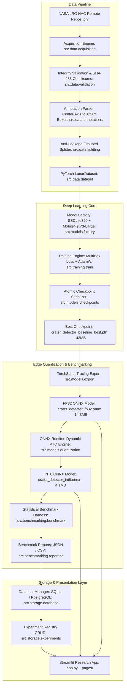

# End-to-End System Architecture

**Project:** Micro-Quantized CNN for Onboard Crater Detection — Chandrayaan-Inspired Lunar Research  
**Document:** System Architecture Specification  

---

## 1. High-Level Architectural Diagram

---

## 2. Component Subsystems

### 2.1 Data Subsystem (`src/data/`)
- **`acquisition.py`:** Handles network downloads with exponential backoff retries, SHA-256 verification, and fallback file catalogs.
- **`annotations.py`:** Parses elliptical crater representations and converts them to axis-aligned bounding boxes.
- **`dataset.py`:** Custom `torch.utils.data.Dataset` implementing bilinear image resizing to $320 \times 320$, ImageNet tensor normalization, and coordinate scaling.
- **`splitting.py`:** Group-based splitting algorithm grouping image crops by observation ID to enforce zero geographic overlap between train, validation, and test splits.
- **`validation.py`:** Validates image file headers, dimensions, and cryptographic signatures.

### 2.2 Deep Learning & Model Subsystem (`src/models/`)
- **`factory.py`:** Configures SSDLite with depthwise separable prediction heads and ImageNet pre-trained MobileNetV3-Large backbone.
- **`checkpoints.py`:** Atomic checkpoint serialization using temporary file writing and renaming to protect against disk corruption.
- **`export.py`:** Traces the PyTorch model graph into an ONNX representation (`dynamo=False`) with embedded Non-Maximum Suppression.
- **`quantization.py`:** Applies ONNX Runtime dynamic PTQ, quantizing weights to `QInt8` while preserving spatial coordinate operations in FP32.
- **`inference.py`:** Unified high-level inference interface (`CraterDetector`) supporting PIL images, file paths, and NumPy arrays with automatic pre/post-processing.

### 2.3 Training & Evaluation Subsystem (`src/training/`)
- **`train.py`:** Training loop orchestrating forward passes, MultiBox loss computation, gradient clipping, and checkpoint evaluation.
- **`evaluate.py`:** Runs validation and test evaluation routines, computing AP@0.50 and mAP@0.50:0.95.
- **`metrics.py`:** Pure NumPy/PyTorch implementations of IoU, Precision, Recall, and Average Precision.

### 2.4 Benchmarking & Reporting Subsystem (`src/benchmarking/`)
- **`benchmark.py`:** Multi-repetition latency and throughput measurement with untimed warmup cycles and CPU memory monitoring.
- **`reporting.py`:** Formats and saves structured benchmark comparison reports in JSON and CSV.

### 2.5 Storage Subsystem (`src/storage/`)
- **`database.py`:** Database abstraction providing default zero-dependency local SQLite storage, with automatic fallback handling if PostgreSQL credentials fail.
- **`experiments.py`:** CRUD operations for logging experiments, metadata, and JSON benchmark payloads.

### 2.6 Presentation Subsystem (`pages/` & `app.py`)
- Built using **Streamlit 1.66.0** with **`st.navigation`**, custom high-contrast dark lunar CSS, interactive Plotly visualizations, and 8 dedicated research pages.
