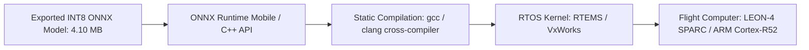

# Deployment & Operational Run Guide

**Project:** Micro-Quantized CNN for Onboard Crater Detection — Chandrayaan-Inspired Lunar Research  
**Document:** Workstation Setup, Pipeline Reproduction, and Embedded Spacecraft Deployment  

---

## 1. Local Workstation Setup (Windows 11)

### 1.1 Prerequisites
- Python 3.10+ (Tested on Python 3.13.5 64-bit)
- PowerShell (Windows 11 native)
- Minimum 4 GB RAM, 2 GB free disk space

### 1.2 Environment Setup
Open PowerShell in the project directory:
```powershell
cd E:\lunar-crater-quantization

# 1. Create Virtual Environment (if not already created)
python -m venv .venv

# 2. Activate Virtual Environment
.venv\Scripts\Activate.ps1

# 3. Upgrade pip and install pinned dependencies
.venv\Scripts\python.exe -m pip install --upgrade pip
.venv\Scripts\python.exe -m pip install -r requirements.txt
```

---

## 2. Running the Research Application

Launch the Streamlit research dashboard:
```powershell
.venv\Scripts\python.exe -m streamlit run app.py --server.port 8501
```
Open your browser to: `http://localhost:8501/`

### Features Accessible in Dashboard:
- **Overview:** Research abstract, model size comparison bar chart, and key metrics.
- **Dataset Inspection:** Interactive tile selector, crater bounding-box overlay, and diameter histograms.
- **Live Crater Detection:** Parallel FP32 vs INT8 inference on uploaded lunar images or built-in test samples.
- **Benchmark Results:** Side-by-side latency distributions, throughput comparisons, and size reduction gauges.
- **Training History:** Training loss curves and epoch metrics.
- **Experiment Registry:** SQLite database viewer with JSON payload inspection.
- **Architecture Details:** SSDLite320 specifications and ONNX operator transformation breakdown.
- **System Diagnostics:** Host CPU/RAM telemetry, artifact checklist, and air-gap verification.

---

## 3. End-to-End Pipeline Reproduction Commands

To reproduce the complete research workflow from scratch:

```powershell
# Step 1: Execute Automated Tests
.venv\Scripts\python.exe -m pytest tests/ -v

# Step 2: Download and Validate LRO NAC Dataset
.venv\Scripts\python.exe scripts/download_data.py --config configs/default_config.yaml

# Step 3: Train Baseline SSDLite320 Model
.venv\Scripts\python.exe scripts/train_model.py --config configs/default_config.yaml --epochs 8

# Step 4: Export to ONNX and Perform Dynamic INT8 Quantization
.venv\Scripts\python.exe scripts/quantize_model.py --config configs/default_config.yaml

# Step 5: Execute Latency & Throughput Benchmark
.venv\Scripts\python.exe scripts/benchmark_models.py --config configs/default_config.yaml --repetitions 30
```

---

## 4. Spacecraft Embedded Deployment Architecture

For deployment on actual planetary spacecraft flight computers:



### Steps for Flight Software Engineers:
1. **Model Export:** The INT8 ONNX model (`artifacts/quantized/crater_detector_int8.onnx`) is copied into the flight software build tree.
2. **C++ Runtime Binding:** Use the **ONNX Runtime C++ Minimal API** (built with `-DUSE_MINIMAL_RUNTIME=ON`), which strips graph optimization and export code to reduce binary size to under 2 MB.
3. **Deterministic Memory Allocation:** Pre-allocate fixed tensor input buffers ($1 \times 3 \times 320 \times 320$ float32 array = 409.6 KB) and output box buffers in high-reliability rad-hard SRAM to prevent dynamic heap allocation during flight.
4. **Camera Framing Pipeline:** The spacecraft optical camera (such as Chandrayaan's Optical High Resolution Camera - OHRC) feeds raw frames into a hardware DMA buffer that directly populates the pre-allocated input tensor.

